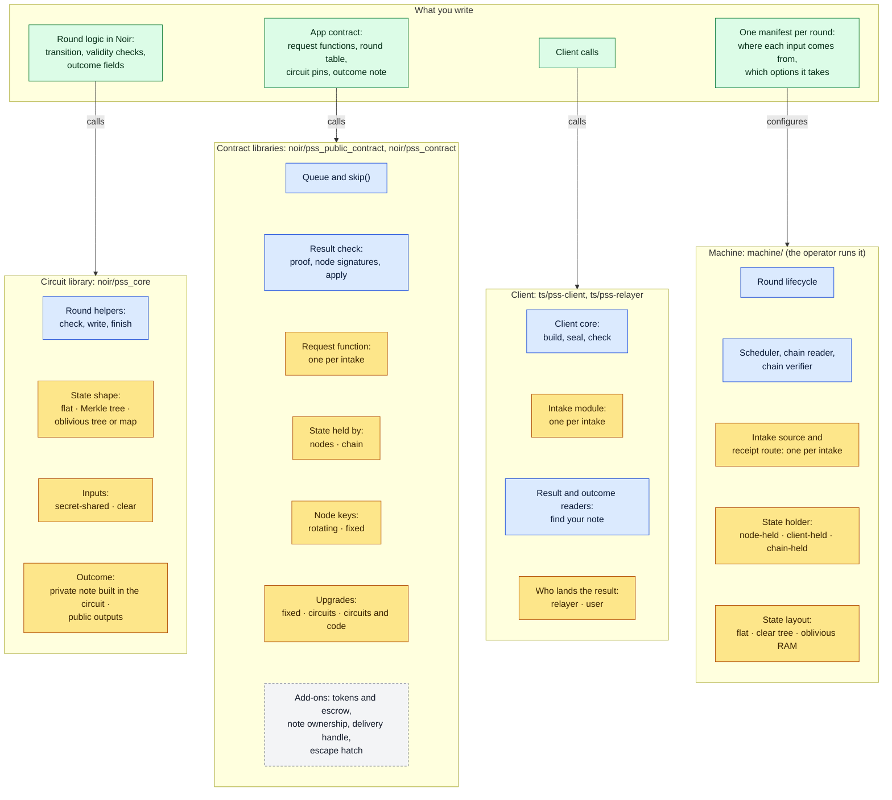
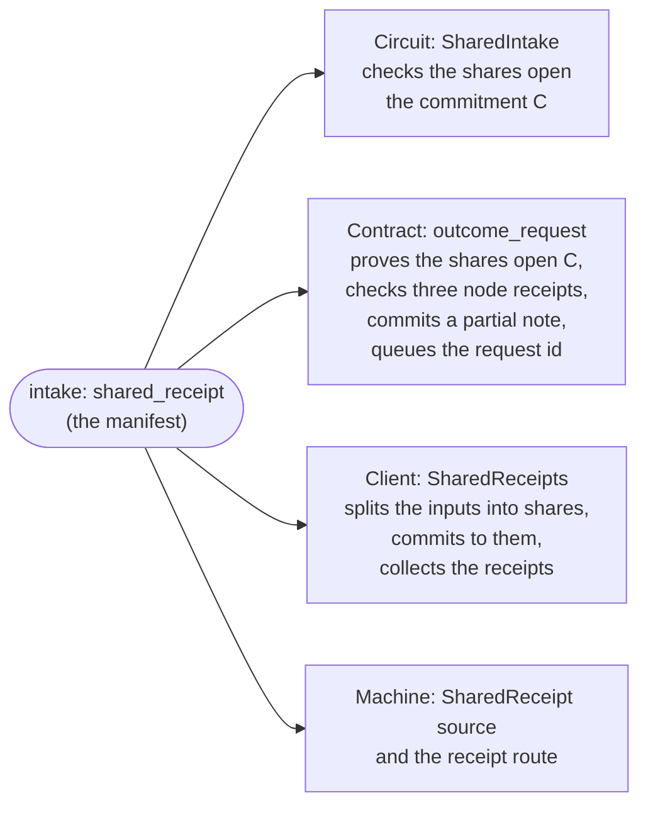
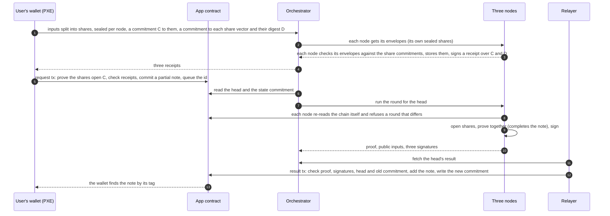
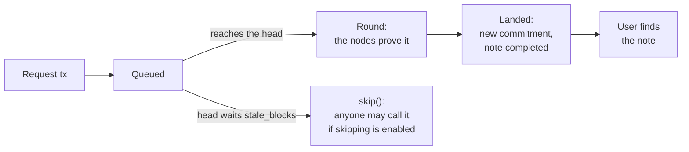
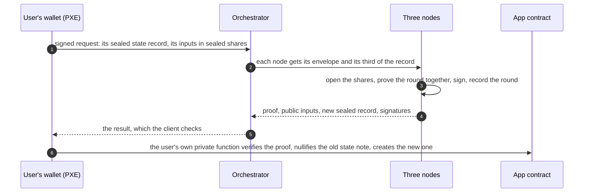

> [!WARNING]
> **This code has not been audited.** It is a research prototype, provided "as is", without warranty of any kind (see [LICENSE](LICENSE)). A bug can let an invalid round land, take or freeze funds, or leak a secret-shared value. Do not use it with real funds or sensitive data without your own independent review. Report a vulnerability privately, as [SECURITY.md](SECURITY.md) says.

# Aztec private shared state

**Shared state for Aztec apps, held in shares across three nodes.**

Aztec keeps a user's own state in notes that only their owner can read and spend. This
repository lets many users act on shared state, such as an AMM pool's reserves or a
lending market's book. With the defaults of secret-shared receipt intake and node-held
state, shared inputs and state values stay off chain, and each node sees only its own
shares of those values. What others learn depends on the intake, fees and app outputs.
See [who sees what](docs/DESIGN.md#who-sees-what).

Three nodes hold the shared state as secret shares: each node holds two of three random
parts that add up to each value, so no single node can read it. They run an MPC protocol
(multi-party computation: computing on values that no one of them can see). Each state
change is a **round**: the nodes run a Noir circuit on their shares and prove it together
as one **co-SNARK**, a single zero-knowledge proof made jointly by the three. The app's
Aztec contract verifies that proof and records a commitment to the new state.
Everything that does not have to be shared, such as a user's balance, a payout or proof
that a user owns a position, stays in that user's own private notes.

**Who it is for.** Developers who want to build Aztec apps around private shared state
(AMMs, lending markets, auctions, order books, games against the house), and researchers
who want to see what a three-node MPC network can do for Aztec. The repository has the
libraries an app builds on, the node software, and worked examples.

Privacy holds while no two of the three nodes collude and all follow the protocol. Today
one operator runs all three, so you trust that operator with privacy and with liveness,
never with taking your funds. See [who sees what](docs/DESIGN.md#who-sees-what) and the
[glossary](docs/GLOSSARY.md).

Run it from a source checkout on x86_64 Linux. The npm packages are not published to npm.
Start with the [counter-tip walkthrough](examples/counter-tip/README.md#running-it).

## An app is bricks snapped together

You write only what makes your app yours: the state transition, its validity checks, the
outcome a user gets back, and the contract and client entry points around them.
Everything else is a **brick**: a library module with one job, behind one interface.
Each design choice is an **axis** (where the state lives, how inputs reach the nodes, who
lands the result, and so on). For each axis you pick one **option**, and that option plugs
the matching brick into every layer it touches.



The picture shows the tip, the default path; on the sidecar path the contract brick is
`noir/pss_contract` and there is no queue, scheduler or relayer. Green is your code. Blue
bricks are always there. Yellow bricks are sockets: an axis
picks one of the options listed (separated by `·`). Grey bricks are add-ons an app takes
when it needs them. [`BRICKS.md`](docs/design-guide/BRICKS.md) lists every brick, the
library items you call for it, and its alternatives.

One axis choice reaches every layer. Choosing secret-shared receipt intake (the default)
plugs in the matching brick in each layer:



Choosing secret-shared on-chain intake instead swaps the contract, client and machine
bricks for their on-chain counterparts and keeps the same circuit brick.

### The axes

| Axis | The question it answers | Options (default in bold) | Chosen in |
| --- | --- | --- | --- |
| Path | Does the result land through a public queue, or in the user's own transaction? | **tip**, sidecar | follows from the intake |
| State mode | Where does the state live between rounds? | **node-held**, client-held (sidecar only); kept option: chain-held | the manifest's `state` |
| State shape | Is the state a small fixed vector, or a large or growing collection? | **flat**, Merkle tree; experimental: oblivious tree, oblivious keyed map | the manifest's `tree` |
| Intake | How do a request's inputs reach the nodes, and who may see them? | **secret-shared receipt**, secret-shared on-chain, receipt, on-chain, direct (sidecar only); deferred: relayed | the manifest's `intake` |
| Binding | Which state does a queued request run against? | **turn** (the state when its turn comes), none (sidecar); deferred: exact | the manifest's `binding` |
| Outputs | Who may learn the round's outcome? | **private** (the requester only), public | follows from the intake |
| Value delivery | Does the round move value to the user? | **partial-note completion**, none | the manifest's `outcome` |
| Delivery | Must the circuit itself build and encrypt what the user receives? | **constrained in the circuit**, clear (nothing private to deliver) | follows from the outputs |
| Submission | Who sends the transaction that lands the result? | **relayer**, user (or anyone) | the deployment |
| Node keys | May the nodes' keys change after deployment? | **rotating key epochs**, fixed key set | the contract's round table |
| Upgrades | May the circuits, or the contract code, change after deployment? | **fixed**, upgradable circuits, upgradable circuits and contract code | the contract |

Receipt intake and on-chain intake give the nodes every input in the clear; they serve as
test paths. Not every pair of options combines: each option's "Never with" line in
[`BRICKS.md`](docs/design-guide/BRICKS.md) says which do not. The decision tree that walks
these questions in order is the [design guide](docs/design-guide/README.md).

### Blueprints

The [design guide](docs/design-guide/README.md#blueprints) lists the blueprints, examples
and files to start from. For chain-held state, recovery needs the nodes' keys, the package
that decodes the log, and a matching log from the last 64 queue entries or the init round.

### Three examples, snapped together

The same bricks, three different apps. All three run at the tip on node-held state, with
the relayer and rotating node keys; this is where they differ. Each example's README has a
generated "Bricks this example uses" table, and a `// BRICK` comment in its code marks
each seam where another option could plug in.

| Axis | [counter-tip](examples/counter-tip) | [amm-tip](examples/amm-tip) | [lending-tip](examples/lending-tip) |
| --- | --- | --- | --- |
| The app | a private running total | a constant-product pool | a lending market with liquidation |
| Shape | flat: `[total, blinding]` | flat: the two reserves | Merkle tree of positions (also an experimental oblivious-tree deployment) |
| Intake | secret-shared receipt | secret-shared receipt; also the other three queued intakes | secret-shared receipt; the deposit also secret-shared on-chain and, on a test deployment, receipt and on-chain |
| Outcome | private note, completed in the co-SNARK | the same | the same |
| Upgrades | fixed | circuits and contract code | fixed |
| Add-ons | none | none | tokens and escrow, note ownership, delivery handle, escape hatch |

In counter-tip, 55 of the 312 lines of circuits, manifests, contract and deployment are
the app's own (the add rule, its validity check, the request function and the outcome
note); the rest is plumbing every app on its blueprint copies as it is
([file by file](examples/counter-tip/README.md#what-you-write-and-what-is-plumbing)).
Lending writes much more app logic (ten round types, a credit balance, the escape hatch)
on the same queue, result-check and note-completion bricks, plus the tree brick.

## Two ways to run a round

The same nodes serve both paths. Pick one per app.

### At the tip of the chain

For shared state that many users act on: an AMM pool, a lending book, an order book.
Requests queue in the app's public contract and are applied in queue order, each against
the state as it is when its turn comes. The diagram shows the default intake,
secret-shared receipt intake, with the user's value delivered as a partial note.



The **PXE** (private execution environment) is the wallet-side part of Aztec that runs a
user's private functions and keeps the user's notes. The **orchestrator** is the
operator's front process that drives the three nodes. A **partial note** is a note whose
owner is fixed in the request and whose value the round fills in, so the user's value arrives as an ordinary Aztec note that only
the user can read. The **relayer** is the operator's service that lands results; anyone
holding a result may land it instead.

With secret-shared receipt intake, the chain sees the request id and expiry block among
other public effects listed in [Who sees what](docs/DESIGN.md#who-sees-what).
On-chain intake is a test path that puts the inputs in a public request log. With the
default intake in lending's clear-tree deployment, the nodes see which position indices
a round touches, and the chain sees commitments. The orchestrator sees the requester's
network address on receipt routes.

A request's life at the tip:



Tip round circuits are **total**: no input can make them fail to prove, so a request the
state no longer allows still lands, as a no-op with an error code. `stale_blocks` is 50
blocks in the examples.

### Sidecar

For per-user hidden state: a game against the house, a sealed commitment, an allowance.
The user asks the network directly, and the user's own private function lands the
result. There is no queue and no relayer.



A **state record** is the state sealed in three parts, one per node: the user carries it
between rounds but cannot open it.

## Layout

| Path | What |
| --- | --- |
| `machine/` | The Rust machine: `sidecar-core` (the round as a library), `sidecar-node`, `sidecar-orchestrator` (with the tip's scheduler), `sidecar-tip` (chain reader, chain verifier), `sidecar-oblivious` (trees in a distributed oblivious RAM), `sidecar-http` (the TLS and API plumbing both binaries share), `sidecar-test-fixtures` (test code the suites share) |
| `noir/` | The Noir libraries: `pss_core` (round helpers), `pss_utils` (encryption and key exchange), `pss_contract` (the sidecar contract library) and `pss_public_contract` (the tip contract library), with their TXE suites |
| `ts/` | The TypeScript: `pss-client`, `pss-relayer`, `test-support`, and the JSON-import hook in `hooks` |
| `examples/` | Monty Hall, an AMM on each path with the total swap they share, lending with liquidation, a credits ledger, a counter, a reference token. The AMMs are minimal constant-product examples that show the bricks, not a private AMM design: a participant can infer the reserves from its own swaps' outcomes, and the AMMs move no token. The credits ledger mints unbacked credit on `pay` |
| `e2e/` | The end-to-end harness: real proofs on a local Aztec network |
| `testvectors/` | One set of vectors that Rust, TypeScript and Noir all check |
| `scripts/` | Toolchain setup, the gates and the generators ([`docs/TESTING.md`](docs/TESTING.md)) |
| `docs/` | [`GLOSSARY.md`](docs/GLOSSARY.md) (the one glossary), [`ARCHITECTURE.md`](docs/ARCHITECTURE.md), [`DECISIONS.md`](docs/DECISIONS.md), [`DESIGN.md`](docs/DESIGN.md) (trust, setup, operation, configuration, recovery, limits), [`TESTING.md`](docs/TESTING.md), the [design guide](docs/design-guide/README.md), [`PROVENANCE.md`](docs/PROVENANCE.md) |

## Build and test

For a first end-to-end run, see the [counter-tip walkthrough](examples/counter-tip/README.md#running-it).

There are two kinds of check. The **fast checks** compile nothing and finish in about
half a minute. The **slow checks** compile Rust, Noir circuits or Aztec contracts, and the
slowest of them also run the MPC and make real proofs; they take from minutes to most of
an hour.

> **Agents: test with the fast checks for as long as you can.** Run them after every
> change. Move to a slow check only when the change is one they cannot see (Rust, Noir,
> a contract), and then run the cheapest slow check that covers it: one crate, one
> example, one TXE package. Leave the proving checks to the full gate, which runs every
> check once before a merge.

Commands run from the repository root. Times are wall clock on a many-core host; the CI
table in [`docs/TESTING.md`](docs/TESTING.md) gives them on 4 cores. On a shared machine,
run the slow checks under `nice -n 19`.

### Fast checks: no compilation

They need Python 3.11 or later, Node 24 or later, rustfmt, and the root npm install
(`npm ci --no-audit --no-fund`); none needs the pinned toolchain.

```sh
npm test                                            # pss-client and pss-relayer from their TypeScript sources: about 600 tests, 10 s
python3 -I scripts/check-manifests.py               # every manifest against the schema and against its generator (gen-intake.py, gen-access.py)
python3 -I scripts/check-design-space.py            # design-space.json is consistent, and every built brick's paths exist
python3 -I scripts/gen-noir-vectors.py --check      # the Noir tests' copies of the shared test vectors are current
for g in examples/*/circuits/gen-fixtures.py; do python3 -I "$g" --check; done   # the generated Prover*.toml fixtures are current
python3 -I scripts/check-pins.py                    # every pin copied outside toolchain.json agrees with it
python3 -I scripts/check-docs-links.py              # relative links and repository paths in the docs resolve (10 s)
(cd machine && cargo fmt --all -- --check)          # Rust formatting (rustfmt only, no build)
git ls-files -z -- '*.sh' | xargs -0 -n 1 bash -n   # shell syntax
```

With `BB_BIN="$PWD/.tools/bb-6.0.0/bb"` set (an absolute path), `npm test` also runs the
two tests that compute a verification key hash with bb. About 20 tests that compare the
tracked ABI fixtures with a fresh build print `SKIPPED` until the circuits and contracts
have been compiled. CI's `checks` and `typescript` jobs run these commands, plus
shellcheck's errors and `npm run build`.

What the fast checks see: the TypeScript client and relayer, the manifests and their
generators, the design space, the generated vectors and fixtures, the pins, the docs, Rust
formatting and shell syntax. What they cannot see: whether Rust, Noir or a contract
compiles, or what it does.

### Slow checks: compilation, then MPC and proving

The slow checks need the pinned toolchain and prepared data, set up once
([`docs/DESIGN.md`, "Setup"](docs/DESIGN.md#setup)):

```sh
scripts/install-toolchain.sh          # the pinned tools into .tools/ (add --with-foundry for the end-to-end runs)
scripts/bootstrap.sh                  # check the tools, link deps/
npm ci --no-audit --no-fund           # the root workspace
npm ci --prefix scripts/txe --no-audit --no-fund   # the TXE runner
scripts/prepare-data.sh               # compile the round and embedded circuits, write the CRS (every cargo build needs it)
scripts/gen-dev-certs.sh              # the development TLS keys the node tests use
```

Cheapest first. The first group compiles and runs tests but proves nothing:

| Command | What it compiles and checks | Time |
| --- | --- | --- |
| `npm run build` | type-checks every TypeScript workspace (and emits pss-client's and pss-relayer's `dist/`) | 30 s |
| `(cd machine && cargo clippy --release -p <crate> --all-targets -- -D warnings)` | one Rust crate and its tests, with lints | minutes; the whole workspace cold about 20 min |
| `(cd machine && cargo nextest run --release --profile quick [-p <crate>])` | the machine's tests, without the three-party proving tests | the build, then about 25 s of tests |
| `scripts/check-noir.sh examples/<example> --outputs examples/<example>/circuits/outputs.txt` | every round circuit of one example, the Noir tests of pss_core, pss_utils and the example, total-lint, and every fixture executed and its outputs checked; no MPC, no proof | under a minute; lending-tip a few minutes |
| `scripts/check-noir.sh machine` | the machine's test circuits, the same way | under a minute |
| `scripts/check-vectors.sh` | every `testvectors/noir` program against the shared vectors | about 1 min |
| `scripts/check-contracts.sh [<dir>]` | every contract package under `<dir>` (default all) with nargo 1.0.0-rc.3 | seconds to a few minutes; lending's two contracts the longest |
| `scripts/txe.sh --contracts --only <dir>` | the contracts the package deploys, then its TXE suite on a simulated chain (proofs staged, not verified) | 1-5 min per package; the whole config (`--contracts txe.json`) 6-10 min |

The second group runs the three-party MPC and makes real proofs:

| Command | What it runs | Time |
| --- | --- | --- |
| `(cd machine && cargo nextest run --release)` | every machine test, the three-party proving tests included: in-process three-node networks prove real rounds | about 150 s of tests, after the build |
| `scripts/witness-extend.sh examples/<amm-tip or lending-tip>` | every fixture through co-noir's three-party witness extension, the network's MPC solver | about 8 s per fixture: amm-tip 17, lending-tip 127 |
| `e2e/run.sh amm monty` | the sidecar path end to end on a local Aztec network, with real client and network proofs (`EXPECT_REAL_PROOFS` defaults to 1); needs docker and Foundry | about 6 min |
| `E2E_TIP=1 E2E_TIP_DEPLOYMENTS="amm-tip-shared amm-tip amm-tip-stale lending-tip lending-tip-plain" e2e/run.sh amm-tip lending-tip` | the tip path end to end the same way: the scheduler, chain verifier, receipt signer and relayer; runs beside the sidecar run (disjoint ports) | about 17 min |

The **full gate** is every command on this page once, run side by side, so it takes as
long as the longest (the lending end-to-end run). [`docs/TESTING.md`](docs/TESTING.md)
has every command in full (the e2e environment, the on-demand and reorg scenarios), what
each suite proves, its cost, and CI.

To run the services instead of testing them, build the binaries
(`(cd machine && cargo build --release --locked)`) and follow
[`docs/DESIGN.md`, "Running the services"](docs/DESIGN.md#running-the-services).

Every pin is in [`toolchain.json`](toolchain.json): Barretenberg 6.0.0, Noir 1.0.0 for
round circuits, nargo 1.0.0-rc.3 (the compiler aztec-nr v6.0.0 targets) for contracts. The
Noir packages take [total-noir](https://github.com/iAmMichaelConnor/total-noir)'s `total`
library as a Nargo git dependency at the tag `toolchain.json` pins, so nargo fetches it on
first use.

## Trust

Each node holds two of the three shares of every secret-shared value: one node learns
nothing of such a value, any two together learn everything. What one node does see
depends on the intake: every input under receipt and on-chain intake; under the default,
the clear app inputs, the round type and which leaves a round touches in a tree with a
clear index. Privacy assumes the nodes follow the protocol and do not collude.

A contract accepts a round only with a proof under its pinned verification key (at the tip,
also with the three nodes' signatures; a sidecar-path contract checks none). A leak of all
three nodes' secrets cannot take or lose anyone's funds (the design's invariant 0), but it
can freeze them. Escrow and the usage deposit are app choices. Counter-tip takes neither.
A deployment that takes escrow refunds it and any usage deposit through `skip()` if it
enables the stale period and calls `token::refund_skipped` in its skip wrapper.

Value held in a shared book (the lending example's collateral and supply) moves only by a round or
through the escape hatch, and nodes that keep landing rounds while refusing service keep
the hatch shut for as long as they do so. Liveness needs all three nodes, the orchestrator
and a submitter. Where enabled, the stale rule lets anyone skip a stalled head after
`stale_blocks`.

The `account` fee method names the sender as fee payer and links its requests. The
default `wfj` names the fee contract as payer without naming the sender. See [who sees what](docs/DESIGN.md#who-sees-what).

Other ways to learn about the state include the following.

- **A participant's own outcomes.** A user learns what its outcomes determine: two swaps
  of the AMM example give the pool's reserves.
- **Outcomes before finality.** The nodes run a round and sign its result on proposed
  blocks, so a requester can open its outcome before its request is final. A replaced block
  that then removes the request (its slot's proposer abandoning the block, an epoch prune,
  an L1 reorg) gives that outcome away for free: the request changes no state and charges no
  fee, while a proposer that abandons its block loses that slot's checkpoint, fees and
  rewards. This assumes each node reads the chain through its own Aztec node
  (docs/DESIGN.md, "Replaced blocks").
- **The user's Aztec node.** pss-client finds outcomes by asking the user's Aztec node for
  each request's tag, so that node can link the user's requests to one another. With a
  `keyEpochNode`, the client takes the node key set after a rotation from that Aztec
  node's storage, unchecked: a lying node can make it seal shared inputs to keys the
  network does not hold. Use an Aztec node you trust, ideally your own.
- **Network addresses.** The orchestrator sees a user's network address on the receipt
  route.

The full table of who sees what, the operator's procedures and the limits are in
[`docs/DESIGN.md`](docs/DESIGN.md).

## License

Apache-2.0. See [LICENSE](LICENSE) and [NOTICE](NOTICE) for the third-party code this
repository carries.
